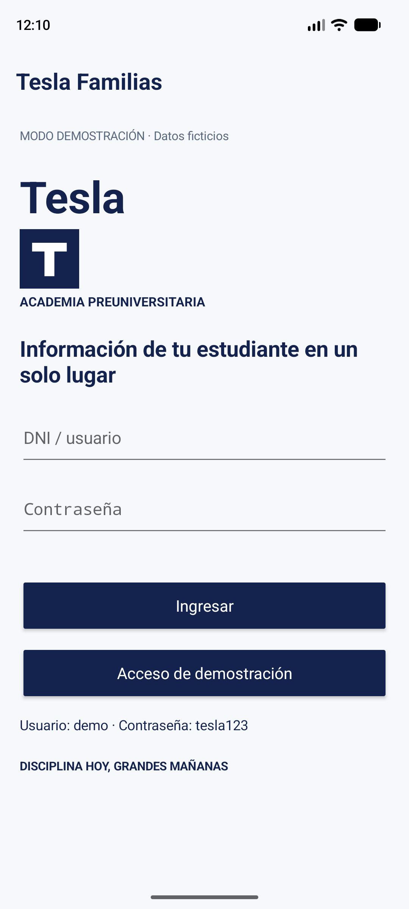
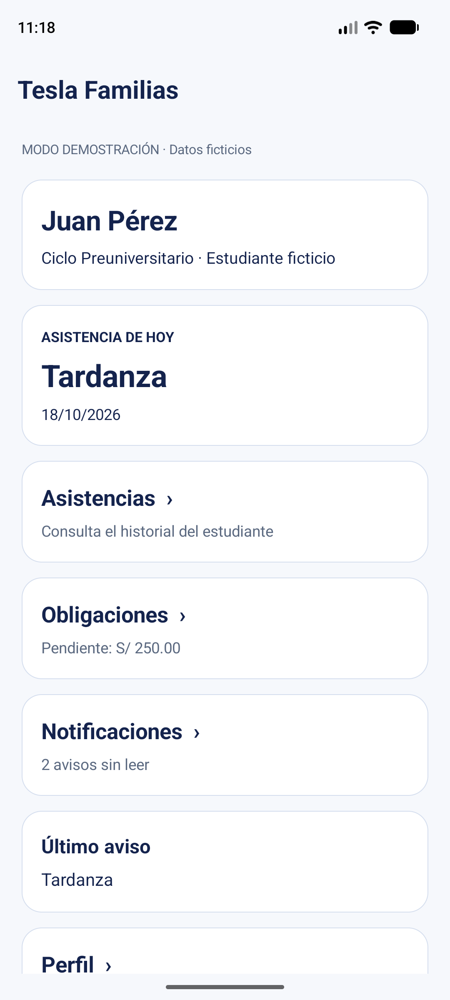
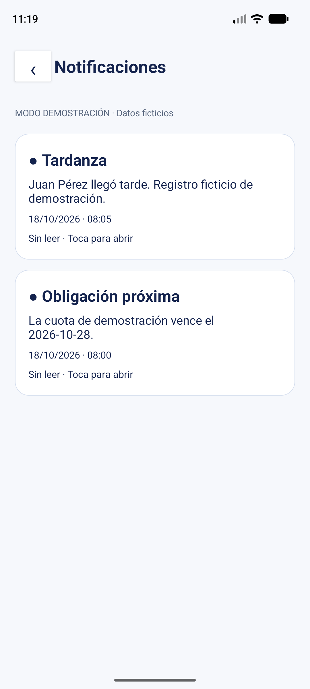

# Tesla Familias

## Entrega final — Módulo 8

**Autor:** Royer Alexander Chavez Malaver

**Curso:** Desarrollo de Aplicaciones Móviles

**Versión:** 1.0.0

**Fecha:** 18 de octubre de 2026

## Descripción del proyecto

Tesla Familias es una aplicación Android para padres o apoderados de estudiantes de la Academia Preuniversitaria Tesla. Permite consultar asistencias, obligaciones económicas y avisos desde el teléfono.

Con este proyecto busco reunir la información que el padre necesita revisar sobre su hijo, sin tener que consultar distintas secciones de una plataforma web o esperar una comunicación de la academia. La aplicación está relacionada con SIGAF, el sistema web en el que también estoy trabajando. Para esta entrega desarrollé una demostración local con un estudiante ficticio, de modo que las funciones se puedan probar sin una cuenta institucional ni un servidor.

El resultado es un producto mínimo viable (MVP) instalable. Incluye las consultas, un historial de avisos y un administrador de demostración para modificar los datos y comprobar los cambios dentro de la aplicación.

## Objetivos

El objetivo general fue desarrollar una aplicación Android que permita consultar información de un estudiante mediante una interfaz sencilla.

Los objetivos específicos fueron:

- Consultar presencias, tardanzas e inasistencias.
- Mostrar obligaciones económicas y su estado, sin procesar pagos.
- Conservar los avisos y distinguir los leídos de los pendientes.
- Guardar la sesión y los cambios en el teléfono.
- Generar una notificación local de prueba.
- Permitir restablecer los datos para repetir la demostración.

## Funciones de la aplicación

| Pantalla | Funciones |
|---|---|
| Acceso | Validación de credenciales de prueba y entrada directa al modo demo |
| Inicio | Estudiante, asistencia del día, total pendiente y cantidad de avisos sin leer |
| Asistencias | Historial con fecha, día, estado y detalle |
| Obligaciones | Importe, vencimiento, estado y total pendiente; una cuota pagada no se suma al total |
| Notificaciones | Historial, fecha y hora, detalle y marcado de lectura |
| Perfil | Datos del apoderado y estudiante; cierre de sesión |
| Administrador demo | Cambio de asistencia, edición de obligación, aviso local y restablecimiento |

La sesión y los registros permanecen guardados al cerrar la aplicación. El botón de regreso permite volver a Inicio. Al tocar una notificación del teléfono se abre el historial; si la sesión está cerrada, primero se solicita el acceso.

El conjunto inicial contiene a Juan Pérez, cinco registros de asistencia, una obligación de S/ 250.00 y dos avisos. Las fechas se calculan al preparar o restablecer la demostración. Si después no hay registro para el día actual, Inicio muestra “Sin registro”.

## Instalación y acceso

1. Descargar `TeslaFamilias-1.0.0.apk`, incluido en el paquete de entrega y en la carpeta `entrega` del proyecto.
2. Copiarlo al teléfono y abrirlo. Si Android lo solicita, permitir la instalación desde la aplicación utilizada para abrir el archivo.
3. Instalar **Tesla Familias** y abrirla.
4. Pulsar **Acceso de demostración** o utilizar estas credenciales:

   - **Usuario:** `demo`
   - **Contraseña:** `tesla123`

5. Para ver un aviso en la barra del teléfono, permitir las notificaciones cuando Android lo solicite.

La aplicación está configurada para Android 8.0 o superior. La comprobación de esta entrega se realizó en un emulador Pixel 8 con Android 17 (API 37). No necesita Internet durante la demostración. El APK utiliza la firma de desarrollo de Android y se entrega para instalación y evaluación académica.

## Recorrido para probarla

1. Entrar a la demostración y consultar Asistencias, Obligaciones y Notificaciones.
2. Abrir un aviso, volver a Inicio y comprobar que disminuyó la cantidad de avisos sin leer.
3. Desplazarse hacia abajo en Inicio y abrir **Administrador de demostración**.
4. Cambiar la asistencia, pulsar **Guardar asistencia** y volver a Inicio para revisar el resultado.
5. En el administrador, editar el importe y el vencimiento de la obligación. La fecha se escribe en formato `AAAA-MM-DD`. Guardar y consultar Obligaciones.
6. Marcar la obligación como pagada y comprobar que el total pendiente pasa a S/ 0.00.
7. Pulsar **Generar aviso de asistencia**. Abrir el aviso desde la barra del teléfono y comprobar que también aparece en el historial.
8. Cerrar y abrir la aplicación para revisar que se conserven los datos.
9. Utilizar **Restablecer datos de demostración** para recuperar los valores iniciales. Esta acción pide confirmación.
10. Abrir Perfil y cerrar sesión.

## Pruebas del dispositivo

Desde Perfil se puede abrir un apartado independiente para comprobar componentes del teléfono. No modifica asistencias, obligaciones ni avisos.

- **Sonido:** un botón reproduce un tono breve. Su audibilidad depende del volumen de notificaciones.
- **Canvas:** un lienzo permite mover un punto al tocarlo o arrastrarlo.
- **Sensor:** se muestra el valor del sensor de proximidad. Si no está disponible, se informa sin bloquear la aplicación.

La imagen de la aplicación aparece en Acceso. Las listas organizan los registros y los estados de asistencia. Los clics y los cambios del sensor se atienden mediante eventos de Kotlin, con argumentos como las coordenadas del toque o el valor recibido. Este apartado permite demostrar esos componentes por separado de las funciones principales.

## Desarrollo y organización del código

El proyecto está escrito en Kotlin con Android Studio. La interfaz utiliza componentes nativos de Android, tarjetas y desplazamiento vertical. Mantuve la paleta azul y blanca de los diseños iniciales y adapté la navegación a las funciones de la demostración.

La documentación de Android recomienda separar las responsabilidades de la interfaz y los datos (Android Developers, 2026c). Por eso organicé las pantallas en `MainActivity.kt` y el guardado de registros en `DatosDemo.kt`. Esta separación permite consultar la misma asistencia desde Inicio y desde el historial.

La guía de la capa de datos también explica la importancia de centralizar las consultas y las modificaciones (Android Developers, 2026b). Para este proyecto utilicé SharedPreferences y registros JSON, porque la demostración maneja pocos datos. Si se incorporan varios estudiantes o consultas más complejas, sería necesario revisar esta decisión y usar una base de datos.

Las notificaciones permiten presentar información fuera de la pantalla de la aplicación (Android Developers, 2026a). En Tesla Familias el aviso se genera localmente y su registro se guarda por separado. De esta manera, abrir o retirar el aviso de la barra del teléfono no elimina el historial de la aplicación.

```text
app/src/main/
  AndroidManifest.xml
  java/pe/tesla/familias/
    MainActivity.kt       Pantallas y acciones de los botones
    DatosDemo.kt          Consulta y guardado de los datos
    PruebasDispositivoView.kt Sonido, lienzo táctil y lectura del sensor
  res/
    drawable/            Iconos de la aplicación y los avisos
    values/              Tema y textos de recursos
capturas/                Capturas de la aplicación funcionando
wireframes/              Diseños iniciales
entrega/                 APK y paquete final
```

### Abrir el código y compilar

1. Extraer el ZIP completo y abrir su carpeta raíz en Android Studio.
2. Utilizar Java 25 como JDK de Gradle y sincronizar el proyecto.
3. Instalar Android SDK 36, extensión 19, y Build Tools 36.0.0 si Android Studio los solicita.
4. Seleccionar el módulo `app` y ejecutar en un emulador o teléfono.

El proyecto utiliza Gradle 9.6 y el plugin Android 9.4.1. La primera sincronización necesita Internet para descargar dependencias. Las rutas locales del SDK se configuran en Android Studio y no forman parte del código entregado.

Desde PowerShell, con Java configurado, se puede ejecutar:

```powershell
.\gradlew.bat :app:assembleDebug
```

El APK generado queda en `app/build/outputs/apk/debug/app-debug.apk`. Para ejecutar la revisión de Android:

```powershell
.\gradlew.bat :app:lintDebug
```

## Capturas de la versión final

Las siguientes imágenes corresponden a la aplicación ejecutada en el emulador. Los diseños iniciales se conservan por separado en la carpeta [wireframes](wireframes).

| Figura | Pantalla | Captura |
|---|---|---|
| 1 | Acceso | [Abrir](capturas/01-acceso.png) |
| 2 | Inicio | [Abrir](capturas/02-inicio.png) |
| 3 | Asistencias | [Abrir](capturas/03-asistencias.png) |
| 4 | Obligaciones | [Abrir](capturas/04-obligaciones.png) |
| 5 | Notificaciones | [Abrir](capturas/05-notificaciones.png) |
| 6 | Perfil | [Abrir](capturas/06-perfil.png) |
| 7 | Administrador demo | [Abrir](capturas/07-administrador.png) |
| 8 | Aviso en Android | [Abrir](capturas/08-aviso-android.png) |
| 9 | Pruebas del dispositivo | [Abrir](capturas/09-pruebas-dispositivo.png) |

  

**Nota.** Capturas de Tesla Familias 1.0.0 en el emulador Pixel 8. Los nombres y registros son ficticios.

## Comprobaciones realizadas

Se realizó un recorrido de la aplicación en el emulador Pixel 8 con Android 17 el 18 de octubre de 2026.

| Comprobación | Resultado observado |
|---|---|
| Instalación del APK | Instalación e inicio correctos |
| Acceso sin credenciales | Muestra el error y conserva la pantalla de acceso |
| Acceso de demostración | Abre Inicio con el estudiante ficticio |
| Consultas | Abren Asistencias, Obligaciones, Notificaciones y Perfil |
| Lectura de avisos | Al abrir un aviso, los no leídos cambian de 2 a 1 |
| Regreso del sistema | Desde una sección vuelve a Inicio |
| Cambio de asistencia | Se guardó Presente y apareció en Inicio |
| Edición de obligación | Se guardaron S/ 123.45 y el estado Pagada; el total quedó en S/ 0.00 |
| Persistencia | Los datos editados y la sesión se conservaron tras reinstalar y reiniciar la aplicación |
| Notificación local | Al autorizar el permiso apareció el aviso en Android |
| Apertura del aviso del sistema | Abrió el historial y conservó el registro dentro de la aplicación |
| Restablecimiento | Permitió cancelar; al confirmar recuperó Tardanza, S/ 250.00 y los dos avisos iniciales |
| Importe vacío | Mostró un mensaje de validación sin guardar el dato |
| Cierre de sesión | Regresó a Acceso |
| Compilación y revisión Android | APK generado y lint sin errores |
| Pruebas del dispositivo | Botón de sonido ejecutado sin errores; punto del lienzo responde al toque y sensor muestra valores de proximidad |

Estas comprobaciones corresponden al emulador indicado. No se ha evaluado el uso con familias reales ni la compatibilidad en todos los modelos de teléfono.

## Registro de cambios

### Borrador inicial

Se definieron el problema, los objetivos, las pantallas y el alcance de la aplicación. Se prepararon seis maquetas y se planteó utilizar datos locales para la demostración.

### Avance del módulo 5

Se creó el proyecto Android y la primera implementación en Kotlin. Se incorporaron acceso demo, consultas, Perfil, administrador de prueba y almacenamiento local. El README se actualizó con los diseños, las decisiones de desarrollo y los pendientes.

### Versión final 1.0.0 — Módulo 8

- Se mejoró Inicio con tarjetas de navegación y resúmenes.
- Se incorporaron iconos de la aplicación y las notificaciones.
- Se ajustaron los márgenes para las barras del teléfono y el teclado.
- Se completó el regreso del sistema y la apertura del historial desde las notificaciones.
- Se conservan los datos del formulario del administrador al recrear la pantalla.
- Se limitó el importe y se mejoró el mensaje de validación.
- Se comprobó el funcionamiento en el emulador y se agregaron capturas reales.
- Se generó el APK 1.0.0 y se preparó el paquete con código e instrucciones.
- Se prepararon el informe, la presentación y el portafolio con QR de descarga.
- Se añadió un apartado independiente para comprobar sonido, lienzo táctil y sensor de proximidad.

### Mejoras posteriores

Conectar la aplicación con SIGAF, incorporar autenticación institucional, consultar varios estudiantes y recibir notificaciones remotas. Estas funciones requieren un backend y quedan fuera de la demostración local entregada.

## Alcance y conclusión

La versión final permite recorrer las funciones previstas del MVP sin depender de servicios externos. El panel de demostración facilita modificar la información y revisar su efecto desde las consultas del apoderado.

La aplicación no procesa pagos, no envía información entre dispositivos y no administra cuentas reales. El acceso demo tampoco representa un sistema de autenticación institucional. Antes de utilizarla con datos reales sería necesario desarrollar esa integración y revisar el tratamiento de la información de los estudiantes.

## Reflexión

La revisión del proyecto muestra que terminar las pantallas es solo una parte del trabajo. La asistencia debe coincidir en Inicio y en el historial, y una obligación pagada debe reflejarse en el total pendiente. Guardar los datos por separado de las pantallas ayudó a mantener esa coherencia. También fue importante distinguir el historial de avisos de la notificación que aparece en el teléfono. Para continuar, priorizaría conectar SIGAF y validar el uso con familias antes de ampliar las funciones.

## Informe presentación y portafolio

- [Informe del proyecto](entrega/documentos/Informe-Tesla-Familias-M8.docx)
- [Presentación de nueve diapositivas](entrega/documentos/Presentacion-Tesla-Familias-M8.pptx)
- [Portafolio y descargas](PORTAFOLIO.md)
- [Paquete completo del proyecto](entrega/Entrega-TeslaFamilias-M8.zip)

## Repositorio

- [Código del proyecto](https://github.com/royerchavez01/tesla-familias-android)
- [README del proyecto](https://github.com/royerchavez01/tesla-familias-android/blob/main/README_Tesla_Familias.md)
- [APK de evaluación](entrega/TeslaFamilias-1.0.0.apk)

## Referencias

Android Developers. (2026a, 28 de mayo). *About notifications in Views*. https://developer.android.com/develop/ui/views/notifications

Android Developers. (2026b, 29 de abril). *Data layer*. https://developer.android.com/topic/architecture/data-layer

Android Developers. (2026c, 5 de octubre). *Guide to app architecture*. https://developer.android.com/topic/architecture
