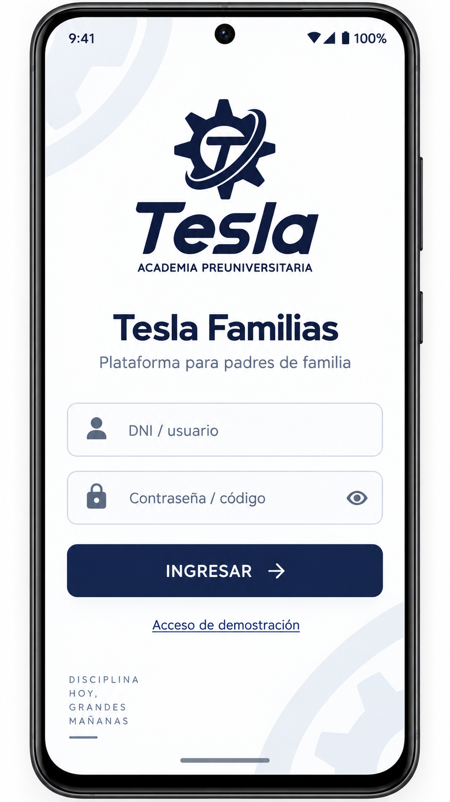
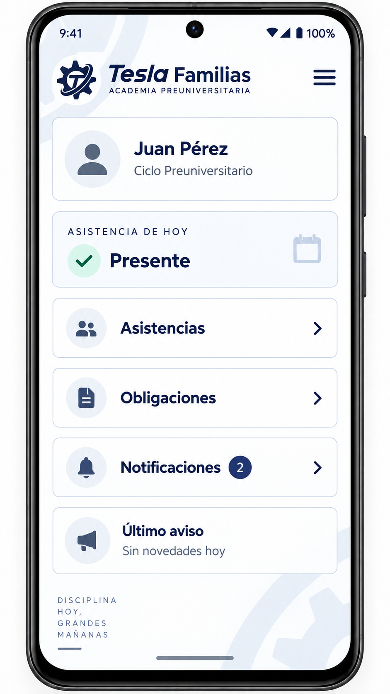
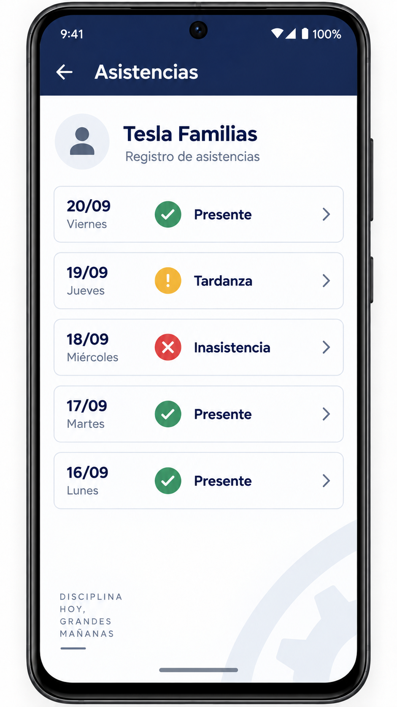
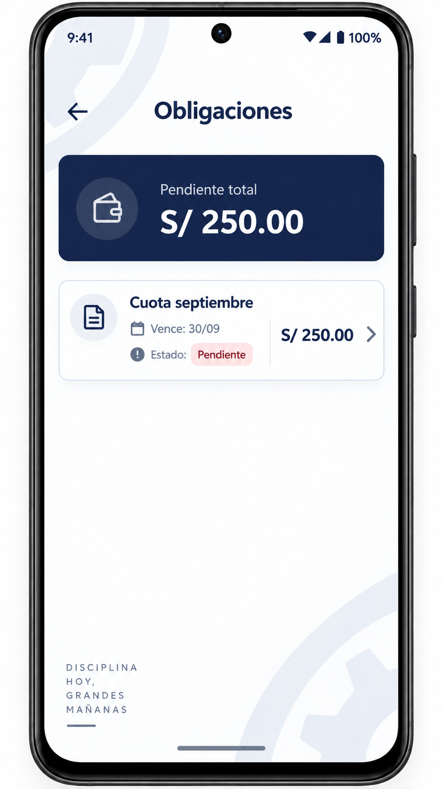
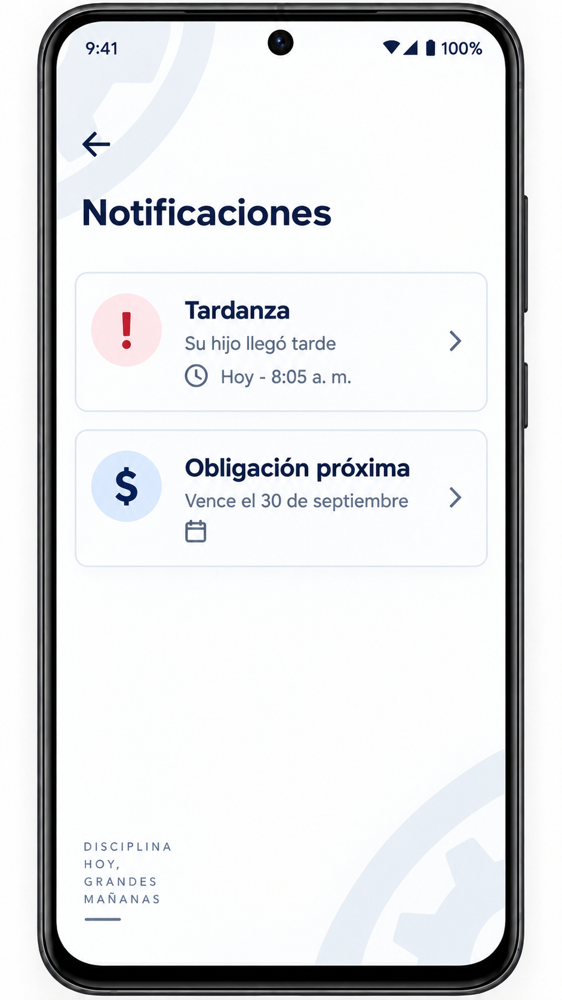
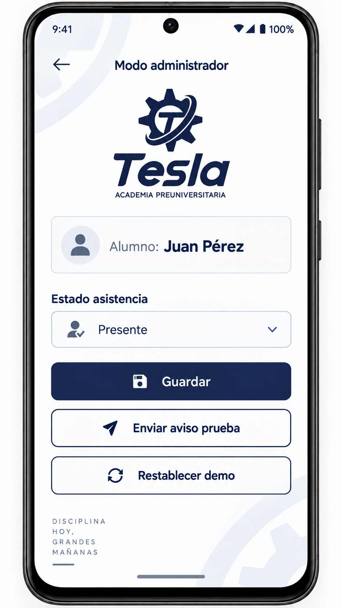

# Tesla Familias

## Avance del proyecto — Módulo 5

**Autor:** Royer Alexander Chavez Malaver

**Curso:** Desarrollo de Aplicaciones Móviles

**Fecha:** 13 de octubre de 2026

**Estado:** Primera versión Android con datos de demostración. La revisión en dispositivo está pendiente.

## Descripción y problema

Tesla Familias es una aplicación Android dirigida a padres o apoderados de la Academia Preuniversitaria Tesla. Busca reunir la información de asistencia, obligaciones económicas y avisos del estudiante en un solo lugar.

El problema identificado para este proyecto es que el padre puede depender de consultas a una plataforma web o de comunicaciones institucionales para conocer novedades. La propuesta consiste en facilitar esa consulta desde el teléfono. Todavía no se ha realizado un estudio con familias que permita medir la demora de las comunicaciones ni demostrar una mejora con la aplicación.

El proyecto se relaciona con el sistema web SIGAF con el que trabaja el autor. Para el curso se desarrollará un producto mínimo viable (MVP) con datos ficticios y funcionamiento local. La integración real con SIGAF quedará para una etapa posterior.

## Objetivos

El objetivo general es desarrollar una aplicación sencilla que permita consultar información de un estudiante y demostrar los flujos principales sin depender de un servidor.

Los objetivos específicos son:

- Mostrar asistencias, tardanzas e inasistencias.
- Consultar obligaciones pendientes sin procesar pagos.
- Consultar avisos y distinguir cuáles se han leído.
- Guardar la sesión y los cambios de la demostración.
- Incluir un panel de prueba para modificar datos y comprobar los resultados.

## Justificación de las decisiones

La documentación de Android recomienda separar las responsabilidades de la interfaz y los datos (Android Developers, 2026c). En esta primera versión, `MainActivity.kt` contiene las pantallas y `DatosDemo.kt` guarda y consulta los registros. Esta separación básica permite que Inicio y Asistencias utilicen la misma información sin repetir los registros en cada pantalla. Todavía no se utiliza ViewModel ni una arquitectura con varias capas.

La guía de la capa de datos explica la importancia de centralizar las consultas y modificaciones (Android Developers, 2026b). Para este avance se emplea una sola clase de datos con SharedPreferences y registros JSON. Se eligió esta solución por el tamaño pequeño de la demostración: un estudiante y una obligación. Si el proyecto crece, será necesario revisar el almacenamiento y considerar una base de datos.

Android permite mostrar notificaciones cuando la aplicación no está abierta (Android Developers, 2026a). El proyecto incluye avisos locales generados desde el panel de prueba. El historial se guarda dentro de la aplicación, por lo que su contenido no depende de que el aviso permanezca en la barra del teléfono. Esto no equivale a recibir avisos enviados desde la academia: esa comunicación requiere una integración remota que todavía no existe.

El modo local permite presentar los flujos sin credenciales reales ni disponibilidad de SIGAF. Su limitación es que solo demuestra el funcionamiento en un dispositivo. Las fuentes utilizadas respaldan las decisiones técnicas; los beneficios para las familias deberán comprobarse posteriormente con usuarios.

## Alcance y avance actual

| Pantalla o función | Avance |
|---|---|
| Acceso | Entrada demo y validación de usuario y contraseña de prueba |
| Inicio | Estudiante, asistencia del día, total pendiente y avisos sin leer |
| Asistencias | Historial y detalle de cada registro |
| Obligaciones | Importe, vencimiento, estado y detalle informativo |
| Notificaciones | Historial, detalle y marcado de lectura |
| Perfil | Datos ficticios del apoderado y estudiante; cierre de sesión |
| Administrador demo | Cambio de asistencia, edición de obligación, aviso de prueba y restablecimiento confirmado |
| Almacenamiento | Sesión y registros guardados localmente |
| Notificación del teléfono | Código incorporado; comprobación en dispositivo pendiente |

Esta es una primera implementación. El APK de desarrollo compiló correctamente el 13 de octubre de 2026 con Java 25, Gradle 9.6 y el plugin Android 9.4.1. La revisión visual y funcional en dispositivo está pendiente. No se presentan las maquetas como capturas de la aplicación funcionando.

Quedan fuera del MVP los pagos en línea, chat, calificaciones, matrícula, geolocalización, biometría y administración real de usuarios. No se usarán datos reales de estudiantes.

## Diseños de las pantallas

Las imágenes siguientes son maquetas del proyecto. La primera interfaz utiliza tarjetas y los colores azul y blanco de estos diseños, pero todavía no reproduce el logotipo ni todos los elementos decorativos.

### Figura 1. Acceso



**Nota.** Maqueta del proyecto. Presenta usuario, contraseña y acceso demo. La implementación permite entrar con datos de prueba y muestra un mensaje si el acceso es incorrecto.

### Figura 2. Inicio



**Nota.** Maqueta del proyecto. Reúne el resumen y los accesos principales. En la implementación, asistencia y contador de avisos se consultan desde los mismos datos locales.

### Figura 3. Asistencias



**Nota.** Maqueta del proyecto. Distingue presencia, tardanza e inasistencia mediante texto y color. La primera versión muestra fechas completas y un detalle sencillo.

### Figura 4. Obligaciones



**Nota.** Maqueta del proyecto. Muestra una cuota y el total pendiente. En el código, una obligación pagada deja de sumarse al total pendiente.

### Figura 5. Notificaciones



**Nota.** Maqueta del proyecto. Presenta avisos de asistencia y vencimiento. La implementación permite abrirlos y guardarlos como leídos.

### Figura 6. Administrador de demostración



**Nota.** Maqueta del proyecto. Incluye cambio de asistencia, aviso y restablecimiento. La implementación añade la edición de la obligación, que todavía no aparece en esta imagen.

### Pendientes del diseño

Las maquetas de Inicio y Notificaciones muestran una presencia y una tardanza para el mismo día. En los datos iniciales de la aplicación se usa una tardanza para mantener la coherencia. Las imágenes originales aún deben ajustarse.

Falta una maqueta de Perfil, aunque la pantalla básica ya está incorporada. También se debe uniformar la navegación y comprobar tamaños, desplazamiento y legibilidad en un teléfono.

## Organización del código

```text
app/src/main/
  AndroidManifest.xml
  java/pe/tesla/familias/
    MainActivity.kt   → pantallas y acciones de los botones
    DatosDemo.kt      → consulta y guardado de datos ficticios
  res/values/
    styles.xml       → tema de la aplicación
```

La navegación parte de Acceso hacia Inicio. Desde Inicio se abren Asistencias, Obligaciones, Notificaciones, Perfil y Administrador demo. El cierre de sesión regresa a Acceso.

La demostración contiene un estudiante, cinco registros iniciales de asistencia, una obligación y dos avisos. El administrador modifica la asistencia del día y la obligación. Restablecer recupera los datos iniciales después de confirmar la acción.

## Cómo ejecutar el avance

El proyecto está escrito en Kotlin y utiliza el plugin Android 9.4.1 y Gradle 9.6. La compilación fue comprobada con Java 25. El nivel 17 configurado para el código compilado no significa que deba instalarse Java 17 para ejecutar Gradle.

1. Abrir la carpeta raíz en Android Studio y sincronizar Gradle.
2. Instalar Android SDK 36, extensión 19, y Build Tools 36.0.0 si se solicitan.
3. Seleccionar un emulador o dispositivo Android 8.0 o superior y ejecutar el módulo `app`.
4. Pulsar **Acceso de demostración** o usar `demo` como usuario y `tesla123` como contraseña.

Para compilar desde PowerShell con Java configurado:

```powershell
.\gradlew.bat :app:assembleDebug
```

El APK de desarrollo se genera en `app/build/outputs/apk/debug/app-debug.apk` si la compilación termina correctamente. La aplicación no necesita conexión a SIGAF; la primera descarga de dependencias sí necesita Internet.

## Comprobaciones previstas

Se revisará manualmente que el acceso funcione, que un cambio de asistencia aparezca en Inicio, que editar la obligación actualice el total y que abrir un aviso reduzca los no leídos. También se comprobará que los datos permanezcan al cerrar y abrir la aplicación, que el cierre de sesión funcione y que restablecer recupere la demostración.

Las notificaciones del teléfono y la apariencia se revisarán en dispositivo o emulador. Estas comprobaciones todavía no se presentan como realizadas. Para este avance no se incluye una suite de pruebas automatizadas.

## Registro de cambios

### Pasados — Borrador inicial

Se definieron problema, plataforma, alcance, pantallas y una propuesta de arquitectura. El README anterior identificaba esta etapa como Módulo 1. No se atribuyen avances a otros módulos sin documentación disponible.

### Actuales — Módulo 5

- Se actualizó el README con objetivos, justificación y referencias.
- Se incorporaron las seis maquetas y sus pendientes.
- Se creó el proyecto Android y una primera interfaz en Kotlin.
- Se añadieron acceso demo, consultas, perfil y administrador de prueba.
- Se incorporó almacenamiento local y código para notificaciones de demostración.
- Se definieron las comprobaciones y los pendientes para la entrega final.

### Futuros — Hasta Módulo 8

- **M6:** comprobar la ejecución y mejorar las pantallas con base en las maquetas.
- **Antes de M7:** publicar código y README actualizado en GitHub Classroom, como indica la consigna.
- **M7:** revisar persistencia y notificaciones en dispositivo; corregir errores y tomar capturas reales.
- **M8:** entregar el MVP funcional, APK e instrucciones actualizadas según los requisitos de esa actividad.
- **Después del curso:** evaluar integración con SIGAF y notificaciones remotas.

## Entrega M5

La consigna solicita una copia del README, su enlace y la publicación del borrador en GitHub Classroom. Este documento incluye el análisis y las citas para atender la rúbrica académica; no se especifica un archivo Word ni una extensión mínima en el texto proporcionado.

Repositorio configurado: [Tesla Familias](https://github.com/royerchavez01/tesla-familias-android).

[Enlace previsto del README](https://github.com/royerchavez01/tesla-familias-android/blob/main/README_Tesla_Familias.md). La versión actual aparecerá allí después de publicar los cambios. Aún debe verificarse que este sea el repositorio de Classroom.

La carpeta `wireframes` debe acompañar al README para mostrar las imágenes. La publicación de este avance está pendiente.

## Referencias

Android Developers. (2026a, 28 de mayo). *About notifications in Views*. https://developer.android.com/develop/ui/views/notifications

Android Developers. (2026b, 29 de abril). *Data layer*. https://developer.android.com/topic/architecture/data-layer

Android Developers. (2026c, 5 de octubre). *Guide to app architecture*. https://developer.android.com/topic/architecture
